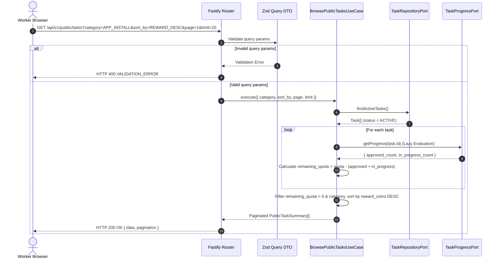
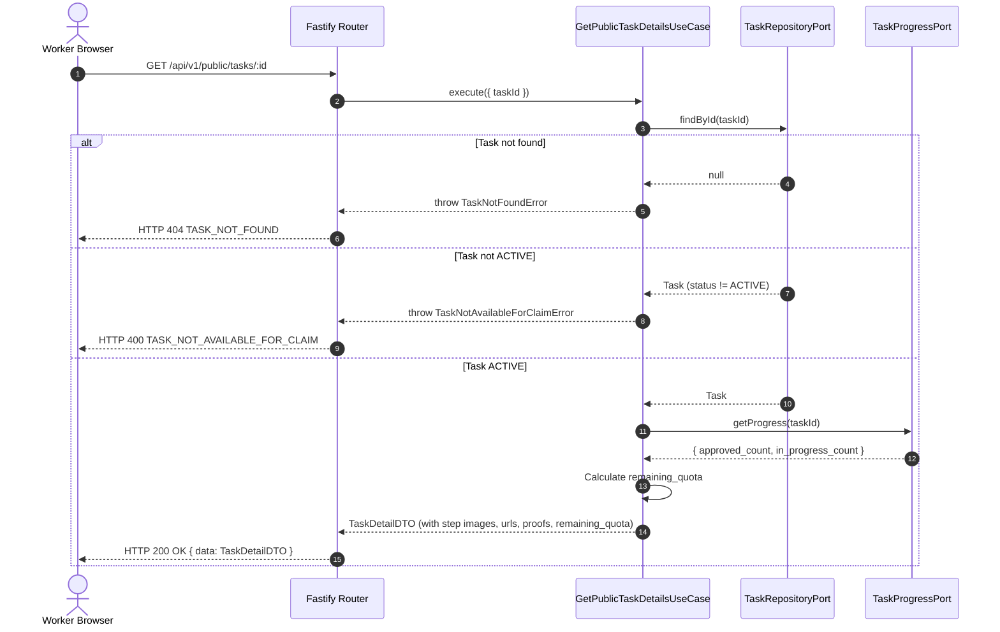
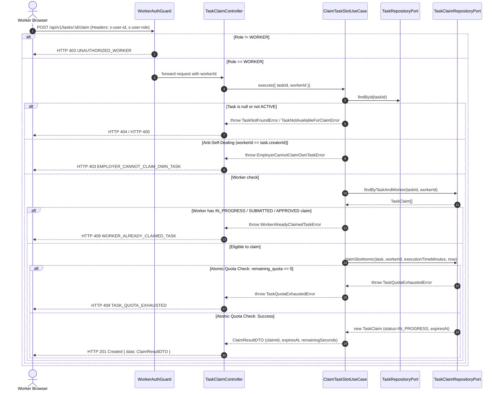
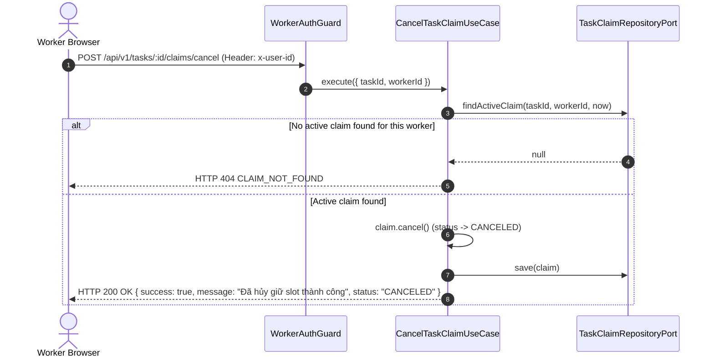
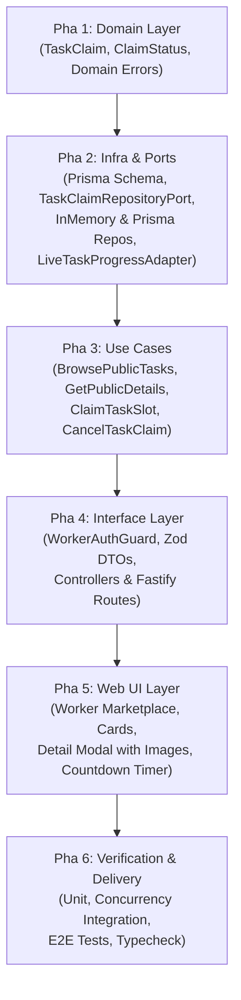

# Kế hoạch kiến trúc: Xem danh sách nhiệm vụ và Nhận việc cho Người làm (browse-and-claim-task)

# Version: 1.0.0
# Status: APPROVED
# Feature Slug: browse-and-claim-task
# Depth: DETAILED
# Architecture Profile: v1.1.0 (APPROVED — Fastify + PostgreSQL + Prisma + Zod + Vitest)
# Methodology Profile: Depth=DETAILED, Risk=elevated, Review Route=Clean Architecture & Concurrency Audit, Decision Owner=Admin (@admin)

---

## 1. Phương cận kiến trúc (Architectural Approach)

Kế hoạch kiến trúc cho tính năng `browse-and-claim-task` tuân thủ nghiêm ngặt chuẩn mực **Clean Architecture / Hexagonal Architecture** theo `CONSTITUTION.md` (`ARCH-01`) và các công nghệ đã được phê duyệt trong `.sdd/architecture-profile.md` (Fastify, PostgreSQL, Prisma ORM, Zod, Vitest):

- **Phân tách 4 tầng kiến trúc độc lập (Separation of Concerns):**
  1. **Domain Layer (`src/domain/`):** Chứa thực thể cốt lõi `TaskClaim`, Value Object / Enum `ClaimStatus`, và các Domain Exceptions chuẩn hóa (`TaskQuotaExhaustedError`, `EmployerCannotClaimOwnTaskError`, `WorkerAlreadyClaimedTaskError`, `UnauthorizedWorkerError`, `ClaimNotFoundError`, `ClaimAlreadyClosedError`). Tầng này là TypeScript thuần túy, **100% không phụ thuộc framework hay ORM ngoại vi**.
  2. **Use Case Layer (`src/usecase/`):** Quản lý toàn bộ 4 luồng ứng dụng:
     - `BrowsePublicTasksUseCase`: Duyệt danh sách việc ACTIVE còn suất, lọc category, sắp xếp thù lao/độ mới, phân trang.
     - `GetPublicTaskDetailsUseCase`: Xem chi tiết nhiệm vụ công khai kèm hình ảnh minh họa các bước và yêu cầu bằng chứng.
     - `ClaimTaskSlotUseCase`: Kiểm tra điều kiện và nhận việc giữ slot (Claim Slot) có thời hạn.
     - `CancelTaskClaimUseCase`: Cho phép Worker chủ động hủy nhận việc để hoàn trả ngay slot trống.
     - Giao tiếp với tầng dưới qua các Port trừu tượng: `TaskClaimRepositoryPort`, `TaskRepositoryPort`, `TaskProgressPort`.
  3. **Interface Layer (`src/interface/`):** Xây dựng Fastify Routes, Controllers, Worker Role Guard (`WorkerAuthGuard`), Presenters và DTO Schemas sử dụng **Zod** để xác thực chặt chẽ đầu vào và chuẩn hóa định dạng phản hồi RFC 7807 (`ENG-02`).
  4. **Infrastructure Layer (`src/infra/`):** Bổ sung bảng `TaskClaim` vào `prisma/schema.prisma`. Triển khai `PrismaTaskClaimRepository` với cơ chế Atomic Transaction / OCC để chống cấp phát vượt trần quota khi có tranh chấp đồng thời; cung cấp `InMemoryTaskClaimRepository` cho unit/integration testing và local dev. Cung cấp `LiveTaskProgressAdapter` triển khai `TaskProgressPort` dựa trên dữ liệu thực tế của `TaskClaim`.
  5. **Web UI Layer (`public/`):** Mở rộng SPA phục vụ trực tiếp từ Fastify backend: Tab "Khám phá việc làm" dành cho Người làm (Worker), Role Switcher mô phỏng (Admin / Worker / Guest), Task Card Grid, Modal xem chi tiết các bước có ảnh minh họa to rõ, và Widget đồng hồ đếm ngược thời gian thực (Countdown Timer).

- **Các mẫu thiết kế cốt lõi (Core Design Patterns):**
  - **Lazy Evaluation Slot Reclaim Pattern:** Khi truy vấn `TaskProgressPort.getProgress(taskId)`, hệ thống đếm số slot chiếm chỗ theo điều kiện `status == 'IN_PROGRESS' && expires_at > now()`. Bất kỳ slot nào quá hạn sẽ tự động không còn chiếm chỗ, giải phóng suất trống tức thì mà không cần cron job nền.
  - **Atomic OCC Concurrency Guard:** Khi Worker nhận việc, Use Case phối hợp với Repository thực hiện thao tác kiểm tra và trừ quota/tạo claim nguyên tử (Atomic Check-and-Insert / Prisma Transaction) đảm bảo tính toàn vẹn tài chính, triệt tiêu nguy cơ over-allocation.
  - **One-Per-Worker Enforcement:** Sử dụng index kết hợp `[worker_id, task_id]` và kiểm tra điều kiện nghiệp vụ: Worker chỉ bị cấm khi đã nộp bài (`SUBMITTED`) hoặc đã được duyệt (`APPROVED`). Nếu claim cũ bị hủy (`CANCELED`) hoặc hết hạn (`EXPIRED`), Worker được phép nhận lại việc.

---

## 2. Ánh xạ Yêu cầu sang Thành phần (REQ-to-Component Mapping)

| Mã yêu cầu | Tóm tắt hành vi | Thành phần đảm nhiệm (Component) | Tầng kiến trúc | Đường dẫn tệp tin dự kiến |
| :--- | :--- | :--- | :--- | :--- |
| `REQ-BCT-001` | Lấy danh sách nhiệm vụ ACTIVE còn suất | `BrowsePublicTasksUseCase` | Usecase | `src/usecase/browse-public-tasks.usecase.ts` |
| `REQ-BCT-002` | Lọc theo danh mục category | `BrowsePublicTasksUseCase` / Query DTO | Usecase / Interface | `src/interface/http/dto/public-task.dto.ts` |
| `REQ-BCT-003` | Sắp xếp theo REWARD_DESC hoặc LATEST | `BrowsePublicTasksUseCase` / Query DTO | Usecase / Interface | `src/interface/http/dto/public-task.dto.ts` |
| `REQ-BCT-004` | Validate query (page, limit, category) | `PublicTaskQueryDto` (Zod Schema) | Interface | `src/interface/http/dto/public-task.dto.ts` |
| `REQ-BCT-005` | Trả mảng rỗng khi không khớp tiêu chí | `BrowsePublicTasksUseCase` | Usecase | `src/usecase/browse-public-tasks.usecase.ts` |
| `REQ-BCT-006` | Xem chi tiết nhiệm vụ kèm ảnh minh họa | `GetPublicTaskDetailsUseCase` | Usecase | `src/usecase/get-public-task-details.usecase.ts` |
| `REQ-BCT-007` | Lỗi 404 TASK_NOT_FOUND khi sai id | `GetPublicTaskDetailsUseCase` / Error | Usecase / Shared | `src/shared/errors/task-errors.ts` |
| `REQ-BCT-008` | Chặn xem chi tiết khi task không ACTIVE | `GetPublicTaskDetailsUseCase` | Usecase | `src/usecase/get-public-task-details.usecase.ts` |
| `REQ-BCT-009` | Nhận việc giữ slot, gán expires_at | `ClaimTaskSlotUseCase` | Usecase | `src/usecase/claim-task-slot.usecase.ts` |
| `REQ-BCT-010` | Lỗi 409 TASK_QUOTA_EXHAUSTED khi hết slot | `ClaimTaskSlotUseCase` / Domain Error | Usecase / Domain | `src/shared/errors/claim-errors.ts` |
| `REQ-BCT-011` | Chống tự gian lận: cấm worker == creator | `AntiSelfDealingValidator` | Domain / Usecase | `src/domain/services/anti-self-dealing.validator.ts` |
| `REQ-BCT-012` | Quy tắc 1 người - 1 việc | `ClaimTaskSlotUseCase` | Usecase | `src/usecase/claim-task-slot.usecase.ts` |
| `REQ-BCT-013` | Xác thực vai trò WORKER | `WorkerAuthGuard` | Interface | `src/interface/http/guards/worker-auth.guard.ts` |
| `REQ-BCT-014` | Kiểm soát đồng thời khi còn 1 slot (OCC) | `TaskClaimRepositoryPort` / Prisma Repo | Usecase / Infra | `src/infra/repositories/prisma-task-claim.repository.ts` |
| `REQ-BCT-015` | Worker chủ động hủy claim hoàn trả slot | `CancelTaskClaimUseCase` | Usecase | `src/usecase/cancel-task-claim.usecase.ts` |
| `REQ-BCT-016` | Lỗi 404/400 khi hủy claim không hợp lệ | `CancelTaskClaimUseCase` | Usecase | `src/usecase/cancel-task-claim.usecase.ts` |
| `REQ-BCT-017` | Lazy evaluation giải phóng slot hết hạn | `TaskProgressPort` / Claim Repo | Usecase / Infra | `src/infra/adapters/live-task-progress.adapter.ts` |
| `REQ-BCT-018` | Giao diện Worker: Khám phá việc làm, lọc, sort | `public/index.html` / `worker-marketplace.js` | Web UI | `public/js/components/worker-marketplace.js` |
| `REQ-BCT-019` | Modal chi tiết nhiệm vụ có ảnh minh họa | `task-claim-modal.js` | Web UI | `public/js/components/task-claim-modal.js` |
| `REQ-BCT-020` | Nút nhận việc, chuyển trạng thái giữ slot | `task-claim-modal.js` / API Client | Web UI | `public/js/api.js` |
| `REQ-BCT-021` | Đồng hồ đếm ngược giữ slot thời gian thực | `countdown-timer.js` | Web UI | `public/js/components/countdown-timer.js` |

---

## 3. Danh mục các Thành phần chi tiết (Components)

### 3.1 Domain Layer (`src/domain/`)

- **`TaskClaim` Entity (`src/domain/entities/task-claim.entity.ts`):**
  - Thực thể quản lý một lượt giữ chỗ nhận việc của Worker.
  - Thuộc tính: `id`, `taskId`, `workerId`, `status: ClaimStatus`, `claimedAt: Date`, `expiresAt: Date`, `submittedAt?: Date | null`, `completedAt?: Date | null`, `createdAt: Date`, `updatedAt: Date`.
  - Nghiệp vụ thực thể:
    - `isExpired(now: Date): boolean`: Kiểm tra xem slot có bị quá hạn so với thời điểm truyền vào không.
    - `canBeCanceled(): boolean`: Chỉ hủy được khi đang `IN_PROGRESS` và chưa hết hạn.
    - `cancel()`: Chuyển trạng thái sang `CANCELED`.
    - `submit()`: Chuyển trạng thái sang `SUBMITTED`.
    - `approve()`: Chuyển trạng thái sang `APPROVED`.
    - `reject()`: Chuyển trạng thái sang `REJECTED`.
- **`ClaimStatus` Value Object / Enum (`src/domain/value-objects/claim-status.vo.ts`):**
  - Quản lý các trạng thái: `IN_PROGRESS`, `SUBMITTED`, `EXPIRED`, `CANCELED`, `APPROVED`, `REJECTED`.
- **Domain Errors (`src/shared/errors/claim-errors.ts`):**
  - Định nghĩa các lỗi nghiệp vụ chuẩn kế thừa `DomainError`: `TaskQuotaExhaustedError` (409), `EmployerCannotClaimOwnTaskError` (403), `WorkerAlreadyClaimedTaskError` (409), `UnauthorizedWorkerError` (403), `ClaimNotFoundError` (404), `ClaimAlreadyClosedError` (400), `TaskNotAvailableForClaimError` (400).

### 3.2 Use Case Layer (`src/usecase/`)

- **`BrowsePublicTasksUseCase` (`src/usecase/browse-public-tasks.usecase.ts`):**
  - Đầu vào: `{ page: number, limit: number, category?: string, sort_by?: 'LATEST' | 'REWARD_DESC' }`.
  - Xử lý: Lấy danh sách nhiệm vụ `ACTIVE` từ `TaskRepositoryPort`. Với mỗi nhiệm vụ, truy vấn `TaskProgressPort` để lấy số slot hợp lệ đang làm (`in_progress_count`) và số bài đã duyệt (`approved_count`). Tính $\text{remaining\_quota} = \text{quota} - (\text{approved\_count} + \text{in\_progress\_count})$. Loại bỏ các nhiệm vụ có $\text{remaining\_quota} \le 0$. Thực hiện lọc category và sắp xếp.
  - Đầu ra: `{ data: PublicTaskSummary[], pagination: { total, page, limit, total_pages } }`.
- **`GetPublicTaskDetailsUseCase` (`src/usecase/get-public-task-details.usecase.ts`):**
  - Đầu vào: `{ taskId: string }`.
  - Xử lý: Tìm nhiệm vụ theo `id`. Kiểm tra tồn tại (ném `TaskNotFoundError` 404) và kiểm tra trạng thái `ACTIVE` (ném `TaskNotAvailableForClaimError` 400). Tính `remaining_quota` động qua `TaskProgressPort`.
  - Đầu ra: Dữ liệu chi tiết đầy đủ của task (bao gồm các steps có ảnh minh họa `imageUrl`, liên kết `targetUrl`, `proof_requirements`, `execution_time_minutes`, `remaining_quota`).
- **`ClaimTaskSlotUseCase` (`src/usecase/claim-task-slot.usecase.ts`):**
  - Đầu vào: `{ taskId: string, workerId: string, role: string }`.
  - Xử lý:
    1. Kiểm tra quyền: `role === 'WORKER'` (nếu sai ném `UnauthorizedWorkerError` 403).
    2. Tải `FreelanceTask` từ `TaskRepositoryPort`. Nếu không tồn tại -> 404; nếu trạng thái không `ACTIVE` -> 400.
    3. Kiểm tra Anti-Self-Dealing: `workerId == task.creatorId` -> ném `EmployerCannotClaimOwnTaskError` 403.
    4. Kiểm tra One-Per-Worker: Truy vấn `TaskClaimRepositoryPort.findByTaskAndWorker(taskId, workerId)`. Nếu có bản ghi `IN_PROGRESS` (chưa hết hạn), `SUBMITTED`, hoặc `APPROVED` -> ném `WorkerAlreadyClaimedTaskError` 409.
    5. Kiểm tra Quota & Tạo Claim nguyên tử: Gọi `TaskClaimRepositoryPort.claimSlotAtomic(task, workerId, executionTimeMinutes, now)`. Nếu không còn suất trống -> ném `TaskQuotaExhaustedError` 409.
  - Đầu ra: Thông tin claim vừa tạo `{ claim_id, task_id, worker_id, status: 'IN_PROGRESS', claimed_at, expires_at, remaining_seconds }`.
- **`CancelTaskClaimUseCase` (`src/usecase/cancel-task-claim.usecase.ts`):**
  - Đầu vào: `{ taskId: string, claimId: string, workerId: string }`.
  - Xử lý: Tìm claim theo `claimId`. Kiểm tra tồn tại và `claim.workerId === workerId` (nếu sai ném `ClaimNotFoundError` 404). Kiểm tra trạng thái: nếu không phải `IN_PROGRESS` ném `ClaimAlreadyClosedError` 400. Gọi `claim.cancel()` và lưu qua `TaskClaimRepositoryPort.save(claim)`.
  - Đầu ra: `{ success: true, message: "Đã hủy giữ slot thành công", status: "CANCELED" }`.
- **Application Ports (`src/usecase/ports/`):**
  - `TaskClaimRepositoryPort` (`src/usecase/ports/task-claim-repository.port.ts`): Quản lý lưu trữ, truy vấn claim, đếm claim hợp lệ và thực thi atomic claim slot.
  - `TaskProgressPort` (`src/usecase/ports/task-progress.port.ts`): Tái sử dụng port hiện có, lấy `{ approved_count, in_progress_count }`.

### 3.3 Interface Layer (`src/interface/`)

- **Fastify Controllers & Routes:**
  - `PublicTaskController` (`src/interface/http/controllers/public-task.controller.ts`): Điều phối HTTP cho danh sách và chi tiết public tasks.
  - `TaskClaimController` (`src/interface/http/controllers/task-claim.controller.ts`): Điều phối nhận việc, hủy claim và kiểm tra claim hiện tại của worker.
  - Routes:
    - `src/interface/http/routes/public-task.routes.ts`: Đăng ký `GET /api/v1/public/tasks` và `GET /api/v1/public/tasks/:id`.
    - `src/interface/http/routes/claim.routes.ts`: Đăng ký `POST /api/v1/tasks/:id/claim`, `POST /api/v1/tasks/:id/claims/cancel`, `GET /api/v1/tasks/:id/my-claim`.
- **Auth Guard:**
  - `WorkerAuthGuard` (`src/interface/http/guards/worker-auth.guard.ts`): Đọc `x-user-role` và `x-user-id` (hỗ trợ chuyển đổi vai trò ở môi trường dev/demo).
- **Zod DTOs:**
  - `PublicTaskQueryDto` (`src/interface/http/dto/public-task.dto.ts`): Validate query params `page`, `limit`, `category`, `sort_by`.
  - `ClaimTaskParamDto` (`src/interface/http/dto/claim.dto.ts`): Validate route params `taskId`, `claimId`.

### 3.4 Infrastructure Layer (`src/infra/`)

- **Prisma Schema Update (`prisma/schema.prisma`):**
  - Bổ sung Model `TaskClaim` có quan hệ với `Task`, có các index tối ưu hóa: `[task_id, status]`, `[worker_id, task_id]`, `[expires_at]`.
- **`PrismaTaskClaimRepository` (`src/infra/repositories/prisma-task-claim.repository.ts`):**
  - Triển khai `TaskClaimRepositoryPort`.
  - Luồng `claimSlotAtomic`: Chạy trong một Prisma Transaction `$transaction(async (tx) => ...)`. Thực hiện khóa hoặc đếm số claim `IN_PROGRESS` (có `expires_at > now()`) + `APPROVED` trong task. Nếu $\ge \text{quota}$ thì ném `TaskQuotaExhaustedError`. Nếu còn suất thì tạo bản ghi `TaskClaim` mới.
- **`InMemoryTaskClaimRepository` (`src/infra/repositories/in-memory-task-claim.repository.ts`):**
  - Triển khai in-memory thread-safe / atomic simulation cho môi trường test và local dev không có Postgres.
- **`LiveTaskProgressAdapter` (`src/infra/adapters/live-task-progress.adapter.ts`):**
  - Triển khai `TaskProgressPort` bằng cách gọi `TaskClaimRepositoryPort.countActiveClaims(taskId, now)` và `countApprovedClaims(taskId)`. Thay thế `StubTaskProgressAdapter` khi chạy live!

### 3.5 Web UI Layer (`public/`)

- **Worker Marketplace Component (`public/js/components/worker-marketplace.js`):**
  - Hiển thị danh sách nhiệm vụ dạng lưới thẻ (Card Grid) trực quan, hiện đại.
  - Thẻ nhiệm vụ: Huy hiệu danh mục, tiêu đề, mức thù lao Xu (màu vàng nổi bật), số suất còn lại (`remaining_quota`), thời gian làm bài tối đa.
  - Thanh công cụ phía trên: Các pill lọc danh mục (Tất cả, Cài đặt ứng dụng, Khảo sát, Đăng ký tài khoản, Đánh giá, Viết bài, ...) và Dropdown sắp xếp (Việc mới nhất, Thù lao Xu cao nhất).
- **Task Claim Modal (`public/js/components/task-claim-modal.js`):**
  - Mở khi Worker nhấn vào một thẻ nhiệm vụ.
  - Hiển thị chi tiết mô tả, danh sách các bước có **hình ảnh minh họa to rõ (Step Images)**, liên kết an toàn (HTTPS-only kèm biểu tượng mở ngoài), danh sách bằng chứng cần nộp.
  - Nút bấm hành động: "Nhận việc ngay" (nếu chưa nhận), hoặc hiển thị trạng thái "Đang làm nhiệm vụ này" kèm đồng hồ đếm ngược.
- **Countdown Timer Widget (`public/js/components/countdown-timer.js`):**
  - Khung thông báo ghim nổi bật khi Worker đang giữ slot làm bài.
  - Đếm ngược từng giây theo `remaining_seconds` từ server; đổi màu cảnh báo đỏ khi thời gian còn dưới 5 phút.
  - Nút "Hủy nhận việc" cho phép Worker trả slot bất kỳ lúc nào.

---

## 4. Luồng dữ liệu (Data Flow)

### 4.1 Luồng duyệt danh sách nhiệm vụ công khai (`GET /api/v1/public/tasks`) — `REQ-BCT-001..005`

### 4.2 Luồng xem chi tiết nhiệm vụ công khai (`GET /api/v1/public/tasks/:id`) — `REQ-BCT-006..008`

### 4.3 Luồng nhận việc giữ slot (Claim Slot Execution) — `REQ-BCT-009..014`

### 4.4 Luồng hủy giữ chỗ (Cancel Task Claim) — `REQ-BCT-015..016`

---

## 5. Phân loại Thay đổi Trạng thái (State-change Classification)

| Luồng / Thành phần | Phân loại thay đổi | Danh mục tác động (State-change Category) | Yêu cầu Checkpoint |
| :--- | :--- | :--- | :--- |
| `GET /api/v1/public/tasks` | Chỉ đọc (Read-only) | `none` | Không bắt buộc |
| `GET /api/v1/public/tasks/:id` | Chỉ đọc (Read-only) | `none` | Không bắt buộc |
| `POST /api/v1/tasks/:id/claim` | Ghi dữ liệu nghiệp vụ | `persistence schema / business-data mutation` | Bắt buộc kiểm thử Unit & Concurrency Test |
| `POST /api/v1/tasks/:id/claims/cancel` | Ghi dữ liệu nghiệp vụ | `persistence schema / business-data mutation` | Bắt buộc kiểm thử State transition |
| `prisma/schema.prisma` update | Thay đổi cấu trúc bảng | `persistence schema` | Kiểm tra migration và backward compatibility |

---

## 6. Tác động Hợp đồng Dùng chung (Shared-contract Impact)

- **`TaskProgressPort` (`src/usecase/ports/task-progress.port.ts`):**
  - **Tình trạng trước:** Tính năng `post-job` sử dụng `StubTaskProgressAdapter` với số liệu giả lập (`approved_count: 0, in_progress_count: 0`).
  - **Tác động sau:** Tính năng `browse-and-claim-task` bổ sung `LiveTaskProgressAdapter` triển khai thực tế trên `TaskClaimRepositoryPort`. Phương thức `getProgress(taskId)` trả về số liệu động thời gian thực:
    - `in_progress_count`: Đếm các bản ghi `TaskClaim` có `status === 'IN_PROGRESS' && expires_at > now()`.
    - `approved_count`: Đếm các bản ghi `TaskClaim` có `status === 'APPROVED'`.
  - **Tính tương thích:** **100% Backward Compatible**. Không sửa đổi chữ ký hàm của `TaskProgressPort`, đảm bảo toàn bộ use case của `post-job` (`UpdateFreelanceTaskUseCase`, `GetFreelanceTaskDetailsUseCase`) hoạt động chính xác mà không cần sửa code.
- **`FreelanceTask` Entity:**
  - Không sửa đổi cấu trúc hay logic của `FreelanceTask`. Mọi liên kết giữa Task và Claim được thực hiện thông qua `taskId` và Ports.

---

## 7. Ma trận Nhất quán (Consistency Map)

| Mã yêu cầu | Thành phần Plan đảm nhiệm | Mã Task dự kiến | Lệnh kiểm định chính xác | Bằng chứng kiểm thử / Trace | Post-code Review Trigger |
| :--- | :--- | :--- | :--- | :--- | :--- |
| `REQ-BCT-001..005` | `BrowsePublicTasksUseCase`, DTO | `T-BCT-001` | `npx vitest run tests/unit/usecase/browse-public-tasks.spec.ts` | Unit test filter, sort, pagination | Có (Public API) |
| `REQ-BCT-006..008` | `GetPublicTaskDetailsUseCase` | `T-BCT-002` | `npx vitest run tests/unit/usecase/get-public-task-details.spec.ts` | Unit test step images, URLs, error 404/400 | Có (Public API) |
| `REQ-BCT-009..014` | `TaskClaim` Entity, `ClaimTaskSlotUseCase` | `T-BCT-003` | `npx vitest run tests/unit/domain/entities/task-claim.spec.ts tests/unit/usecase/claim-task-slot.spec.ts` | Unit test anti-self-dealing, 1-per-worker, quota exhausted | Có (State Mutation) |
| `REQ-BCT-014` | Concurrency OCC Guard | `T-BCT-004` | `npx vitest run tests/integration/concurrency/claim-concurrency.spec.ts` | Concurrency integration test 2 workers 1 slot | Có (Critical Risk) |
| `REQ-BCT-015..017` | `CancelTaskClaimUseCase`, Lazy Reclaim | `T-BCT-005` | `npx vitest run tests/unit/usecase/cancel-task-claim.spec.ts` | Unit test cancel claim & slot return | Có (State Mutation) |
| `REQ-BCT-001..017` | Fastify Routes, Guard, Error Handler | `T-BCT-006` | `npx vitest run tests/integration/api/claim-api.spec.ts` | Fastify integration test HTTP 200/201/400/403/404/409 | Có (Public API) |
| `REQ-BCT-018..021` | Worker Web Marketplace, Modal, Timer | `T-BCT-007` | `npx vitest run tests/e2e/browse-and-claim-ui.spec.ts` | E2E browser / UI verification test | Có (Web UI) |
| Toàn bộ tính năng | Build & Typecheck | `T-BCT-008` | `npx tsc --noEmit && npx vitest run` | 100% test pass, 0 type error | Bắt buộc trước delivery |

---

## 8. Thứ tự Triển khai và Phụ thuộc (Dependencies & Implementation Order)

1. **Bước 1 (Domain):** Xây dựng Entity `TaskClaim`, Value Object `ClaimStatus`, và các `DomainError` liên quan.
2. **Bước 2 (Infrastructure & Ports):** Cập nhật `prisma/schema.prisma` với model `TaskClaim`. Xây dựng `TaskClaimRepositoryPort`, `InMemoryTaskClaimRepository`, `PrismaTaskClaimRepository`, và `LiveTaskProgressAdapter`.
3. **Bước 3 (Use Cases):** Triển khai 4 usecase nghiệp vụ với đầy đủ logic kiểm tra quy tắc Anti-Self-Dealing, One-Per-Worker, và Quota Concurrency.
4. **Bước 4 (Interface & API):** Xây dựng `WorkerAuthGuard`, `PublicTaskQueryDto`, `PublicTaskController`, `TaskClaimController`, đăng ký routes vào `app.ts`.
5. **Bước 5 (Web UI):** Mở rộng giao diện web tại `public/`: bổ sung chế độ xem Worker Marketplace, bộ lọc category, sắp xếp Xu, modal xem chi tiết kèm ảnh minh họa các bước, và widget đồng hồ đếm ngược.
6. **Bước 6 (Kiểm định toàn diện):** Viết bộ kiểm thử Unit, Integration (bao gồm Concurrency Test mô phỏng 2 Worker tranh 1 slot) và E2E Test, chạy `npx tsc --noEmit` và `npx vitest run` đạt 100% pass.

---

## 9. Đánh giá Rủi ro Kỹ thuật & Giải pháp (Risks & Mitigations)

| STT | Rủi ro kỹ thuật tiềm ẩn | Mức độ | Phương án phòng ngừa & Giải pháp (Mitigation) |
| :--- | :--- | :--- | :--- |
| **R1** | **Tranh chấp đồng thời suất cuối cùng (Race Condition / Over-allocation)**: Nhiều Worker cùng gửi request nhận việc tại cùng 1 mili-giây khi nhiệm vụ chỉ còn 1 slot. | Cao | Sử dụng Atomic Conditional Transaction trong `PrismaTaskClaimRepository` / `InMemoryTaskClaimRepository`: chỉ cho phép insert claim khi tổng số slot `IN_PROGRESS` (chưa hết hạn) + `APPROVED` $< \text{quota}$. Nếu điều kiện không thỏa mãn, transaction bị rollback và ném lỗi 409 `TASK_QUOTA_EXHAUSTED`. |
| **R2** | **Lệch giờ giữa Client và Server (Clock Drift)**: Máy tính Worker chỉnh sai giờ dẫn đến đồng hồ đếm ngược hiển thị sai hoặc gửi request hủy claim muộn. | Trung bình | API server luôn tính toán và trả về trường `remaining_seconds` tại thời điểm claim hoặc truy vấn chi tiết. Client UI chỉ đếm lùi số giây này độc lập với đồng hồ máy tính của Worker. |
| **R3** | **Quá tải đọc khi duyệt việc (High Read Throughput)**: Số lượng Worker duyệt danh sách việc làm công khai lớn, liên tục tính toán lại `remaining_quota`. | Trung bình | Truy vấn danh sách chỉ nạp các nhiệm vụ `ACTIVE`; tính toán `remaining_quota` bằng các câu lệnh `COUNT` có index tối ưu `[task_id, status]` và `[expires_at]`. Thiết kế sẵn sàng bổ sung Redis cache ở các pha sau mà không ảnh hưởng Domain. |
| **R4** | **Worker nhận việc nhưng mạng chập chờn (Network Flakiness)**: Worker bấm nhận việc thành công nhưng mất kết nối mạng và bấm lại. | Thấp | Nhờ quy tắc One-Per-Worker: nếu Worker gửi lại request, hệ thống phát hiện claim `IN_PROGRESS` đã tồn tại và trả về mã 409 `WORKER_ALREADY_CLAIMED_TASK` kèm thông tin claim hiện tại để Worker tiếp tục làm bài. |

---

## 10. Câu hỏi cho Human Reviewer (Questions for Human reviewer)

Dưới đây là các điểm giả định thiết kế kỹ thuật (Assumptions) mà AI Agent đã áp dụng trong kế hoạch này để Human Reviewer xem xét:

### Q1: Về cơ chế chuyển đổi vai trò (Role Switcher) trên giao diện Web
- **Điều chưa rõ:** Spec yêu cầu Worker truy cập giao diện khám phá việc làm và bấm nhận việc, nhưng hiện tại hệ thống chưa tích hợp module Đăng nhập/Xác thực tài khoản (Auth Module).
- **Assumption hiện tại:** Kế hoạch áp dụng **Role Switcher** trực quan trên thanh Navigation (cho phép chọn vai trò `Admin`, `Worker (usr-worker-01)`, `Guest`), tự động đính kèm header `x-user-id` và `x-user-role` khi gọi API (tương tự như cách đã làm thành công ở `post-job-ui`).
- **Ảnh hưởng nếu assumption sai:** Nếu người dùng muốn một form đăng nhập riêng, cần bổ sung thêm mock login modal.
- **Câu hỏi cụ thể:** Bạn có đồng ý với giải pháp Role Switcher trên thanh điều hướng để thuận tiện kiểm thử và trải nghiệm ngay không?

### Q2: Về vị trí hiển thị giao diện Worker
- **Điều chưa rõ:** Giao diện Worker nên là một Tab chuyển đổi ngay trong `index.html` hay là một trang HTML riêng biệt (ví dụ `/worker.html` hoặc `/jobs`)?
- **Assumption hiện tại:** Tích hợp thành các Tab điều hướng liền mạch trong Single Page Application (`index.html`) gồm: Tab "Quản trị nhiệm vụ (Admin)" và Tab "Khám phá việc làm (Worker Marketplace)", có đồng bộ URL hash `#worker` / `#admin` để người dùng có thể mở trực tiếp.
- **Ảnh hưởng nếu assumption sai:** Nếu tách thành 2 file HTML riêng biệt, Worker và Admin sẽ ở 2 file khác nhau.
- **Câu hỏi cụ thể:** Bạn có đồng ý tích hợp giao diện Worker thành Tab trong Single Page Application kèm điều hướng URL hash không?

---

## 11. Tiêu chí Hoàn thành (Definition of Done - DoD)

- [x] Kế thừa depth `DETAILED` từ Methodology Profile; deferred scope (nộp bằng chứng, duyệt tiền, rút tiền) không đưa vào Plan.
- [x] Ranh giới 4 tầng Clean Architecture và chiều phụ thuộc inward dependency rõ ràng.
- [x] Toàn bộ 21 yêu cầu `REQ-BCT-001` đến `REQ-BCT-021` được ánh xạ đầy đủ sang component và file path.
- [x] Luồng dữ liệu (Data Flow) chỉ sử dụng các adapter và công nghệ đã được phê duyệt trong Architecture Profile.
- [x] Phân loại thay đổi trạng thái (State-change classification) và yêu cầu checkpoint được xác định cụ thể.
- [x] Tác động hợp đồng dùng chung (`TaskProgressPort`) đảm bảo 100% tương thích ngược với `post-job`.
- [x] Ma trận nhất quán (Consistency Map) liên kết đầy đủ REQs, components, tasks, exact commands và verification evidence.
- [x] Có đủ 4 rủi ro kỹ thuật (Risks) kèm giải pháp phòng ngừa (Mitigations) khả thi.
- [x] Section "Questions for Human reviewer" nêu rõ 2 câu hỏi giả định kỹ thuật (Role Switcher và SPA Tab layout).

---

## AI Agent Recommendation

- **Status:** PENDING HUMAN REVIEW
- **Scope:** Kế hoạch kiến trúc Pha 2 SDD (`PLAN.md`) cho tính năng `browse-and-claim-task`.
- **Recommendation:** Phê duyệt tài liệu `PLAN.md` này để làm cơ sở bước vào Pha 3 Phân rã nhiệm vụ chi tiết (`TASKS.md`). Kiến trúc đảm bảo tính toàn vẹn 100% của Clean Architecture, bảo vệ tài chính chống cấp phát vượt trần (Zero Over-allocation) qua Atomic Concurrency OCC, và tương thích ngược hoàn hảo với `post-job`.
- **Evidence:** Tuân thủ `SPEC.md` v1.0.0 đã được duyệt `APPROVED & LOCKED`, tuân thủ `Architecture Profile v1.1.0` (Fastify, PostgreSQL, Prisma, Zod, Vitest) và `CONSTITUTION.md` (`ARCH-01`, `ENG-02`).
- **Risks and assumptions:** Đã nêu 2 câu hỏi kỹ thuật trong section 10 về Role Switcher và SPA Tab layout; đã thiết kế sẵn sàng kịch bản kiểm thử tranh chấp đồng thời (Scenario 7 BDD).
- **Alternatives considered:** Đã so sánh giữa Cron-based cleanup và Lazy Evaluation. Lazy Evaluation được chọn vì hiệu năng cao, phản hồi tức thì và không phụ thuộc dịch vụ nền.
- **Required human decision:** Human Reviewer có thẩm quyền (Admin) xem xét 2 câu hỏi trong Section 10 và ghi nhận quyết định phê duyệt `APPROVED` để chuyển sang Pha 3 (`TASKS.md`).

---

## Human Final Review

- **Status:** APPROVED
- **Decision:** Duyệt PLAN.md browse-and-claim-task v1.0.0
- **Reviewer:** Admin
- **Reviewed at:** 2026-11-20T00:17:32+07:00
- **Follow-up:** /sdd-tasks --feature=browse-and-claim-task 

