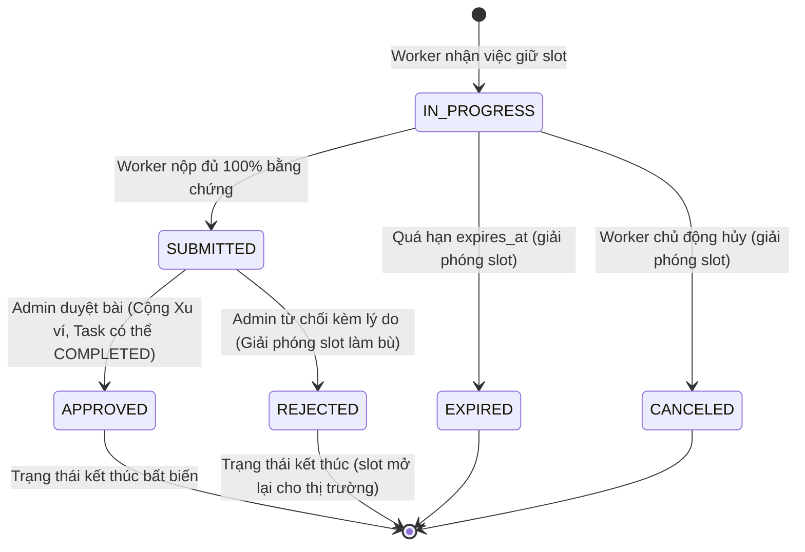
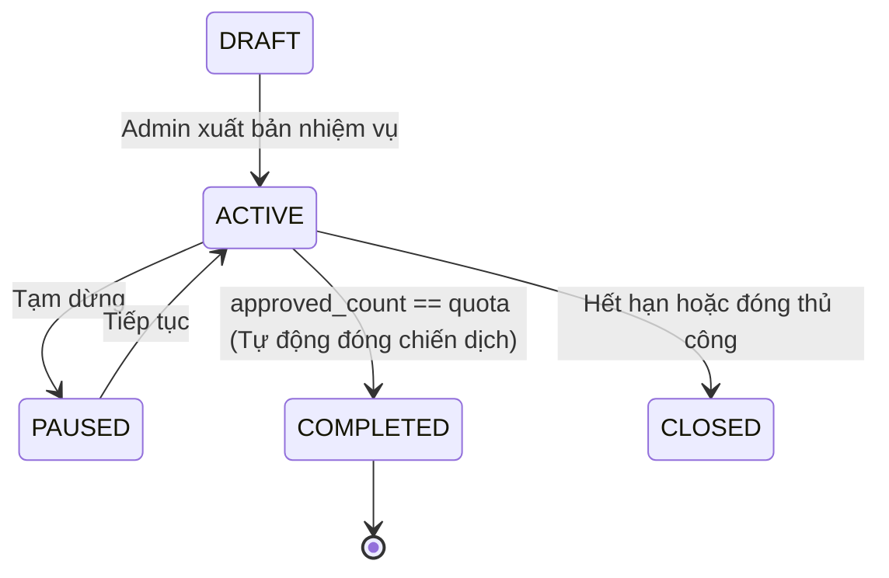

# Ngữ cảnh tính năng: Xem và Duyệt bài nộp bằng chứng cho Admin (review-task-submission)

# Version: 1.0.0
# Status: APPROVED
# Feature Slug: review-task-submission
# Owner: Admin & Employer Experience Team (@architecture-team)
# Mô hình: Quản trị viên (Admin) hoặc Người tạo việc kiểm tra bài nộp bằng chứng của Worker (ảnh chụp, text) ở trạng thái SUBMITTED để Phê duyệt (APPROVED - cộng Xu ví, đóng Task khi đủ quota) hoặc Từ chối (REJECTED - kèm lý do, giải phóng slot bù KPI)

---

## 1. Intent Packet

- **WHAT:** Cung cấp hệ thống API và Giao diện Web Quản trị (Admin Dashboard) cho phép Quản trị viên (Admin) hoặc Người tạo việc (Employer) thẩm định, xét duyệt và nghiệm thu các bài nộp bằng chứng hoàn thành nhiệm vụ của Người làm (Worker):
  1. **Danh sách & Chi tiết bài nộp (Submissions Inquiry & Lightbox Viewer):**
     - Hiển thị danh sách các bài nộp đang chờ xét duyệt (`status = SUBMITTED`), hỗ trợ phân trang và lọc theo nhiệm vụ (`task_id`) hoặc người làm (`worker_id`).
     - Xem chi tiết từng mục bằng chứng: Ảnh chụp màn hình (`SCREENSHOT_IMAGE`) kèm chức năng phóng to (Image Zoom / Lightbox modal), và chuỗi văn bản (`TEXT`) đối soát (mã giao dịch, tên tài khoản, nội dung phản hồi).
     - Hiển thị đầy đủ thông tin ngữ cảnh: Tên nhiệm vụ, mức thưởng Xu, thời điểm nhận việc (`claimed_at`), thời điểm nộp (`submitted_at`), và danh mục các bước hướng dẫn.
  2. **Quy trình Phê duyệt bài nộp (Approve Submission Flow):**
     - Chuyển trạng thái lượt nhận việc `TaskClaim` từ `SUBMITTED` sang `APPROVED`.
     - Ghi nhận dấu thời gian duyệt `reviewed_at = now()` và định danh người duyệt `reviewer_id`.
     - **Cộng Xu thưởng vào ví Worker (Coin Crediting):** Tự động cộng số Xu thưởng (`reward_coins`) tương ứng của nhiệm vụ vào số dư tài khoản của Worker, ghi nhận lịch sử giao dịch ví (`WalletTransaction` với kiểu `TASK_REWARD`).
     - **Cập nhật tiến độ nhiệm vụ & Tự động hoàn thành (Task Auto-completion):** Tăng biến đếm `approved_count` của nhiệm vụ lên 1. Nếu `approved_count == quota` của nhiệm vụ, hệ thống tự động cập nhật trạng thái nhiệm vụ `Task.status` từ `ACTIVE` sang `COMPLETED` (ghi nhận `closed_at = now()`), khép lại chiến dịch thành công.
  3. **Quy trình Từ chối bài nộp (Reject Submission Flow):**
     - Bắt buộc người duyệt phải nhập lý do từ chối (`rejection_reason` từ 10 đến 500 ký tự) để giải thích minh bạch nguyên nhân bài nộp không đạt yêu cầu cho Worker.
     - Chuyển trạng thái `TaskClaim` từ `SUBMITTED` sang `REJECTED`, lưu trữ `rejection_reason`, `reviewed_at`, và `reviewer_id`.
     - **Giải phóng slot làm bù (Slot Release & Quota Rebalance):** Slot bị từ chối được giải phóng khỏi danh sách chiếm dụng. Nhờ đó, số lượng suất khả dụng (`remaining_quota = quota - occupied_slots`) tự động tăng thêm 1 suất trên thị trường việc làm, cho phép các Worker khác (hoặc chính worker đó) nhận làm bù cho đến khi đủ chỉ tiêu chiến dịch.
  4. **Bảo vệ Tính toàn vẹn & Chống duyệt đúp (Idempotency & State Invariance):**
     - Áp dụng kiểm tra trạng thái nghiêm ngặt: Chỉ những lượt claim đang ở trạng thái `SUBMITTED` mới được phép duyệt hoặc từ chối.
     - Ngăn chặn hoàn toàn tình trạng Race Condition / Double Review (Duyệt đồng thời 2 lần dẫn đến cộng Xu 2 lần).
     - Trạng thái `APPROVED` và `REJECTED` là trạng thái kết thúc (Terminal State), bất biến, không thể chỉnh sửa hay hủy bỏ sau khi đã ra quyết định.
  5. **Giao diện Web Quản trị (Admin Web Interface):**
     - Bổ sung tab/khu vực "Duyệt bài nộp" chuyên biệt trên giao diện Admin Dashboard (`/admin`).
     - Bảng danh sách bài nộp trực quan: ảnh thu nhỏ, tên nhiệm vụ, Worker, ngày nộp, mức thưởng Xu, badge trạng thái.
     - Nút "Duyệt bài" (màu xanh lá) có xác nhận nhanh.
     - Nút "Từ chối" (màu đỏ) bật modal bắt buộc nhập lý do từ chối với bộ đếm ký tự (10-500 ký tự).
     - Modal phóng to ảnh chụp màn hình (Image Lightbox) chất lượng cao giúp Admin soi rõ chi tiết bằng chứng.

- **WHY:**
  1. *Khép kín chu trình kinh tế Micro-task:* Đảm bảo Worker được thanh toán thù lao Xu xứng đáng, sòng phẳng ngay khi công việc được nghiệm thu đạt yêu cầu.
  2. *Bảo vệ chất lượng cho Nhà tuyển dụng / Quản trị viên:* Cung cấp công cụ thẩm định trực quan, giúp người tạo nhiệm vụ chỉ trả tiền cho các kết quả thực sự hợp lệ, ngăn chặn gian lận hoặc nộp bằng chứng rác.
  3. *Tự động hóa hoàn thành chiến dịch:* Không cần Admin phải theo dõi số lượng thủ công; hệ thống tự động khóa nhiệm vụ sang `COMPLETED` khi đủ số bài duyệt hợp lệ.
  4. *Đảm bảo KPI chiến dịch thông qua cơ chế giải phóng slot:* Khi bài nộp bị từ chối, slot được tự động mở lại cho cộng đồng nhận làm bù, giúp chiến dịch luôn đạt 100% mục tiêu đầu ra.
  5. *Minh bạch và trải nghiệm người dùng tích cực:* Lý do từ chối rõ ràng giúp Worker hiểu vì sao bài làm không đạt, giảm thiểu tranh chấp và khiếu nại.

- **Definition of Done (DoD):**
  1. **Domain & Data Model:**
     - Mở rộng thực thể `TaskClaim` hỗ trợ phương thức `.approve(reviewerId, now)` và `.reject(reviewerId, rejectionReason, now)`.
     - Cập nhật các Value Object và Domain Errors RFC 7807 (`CLAIM_NOT_IN_SUBMITTED_STATE`, `REJECTION_REASON_TOO_SHORT`, `UNAUTHORIZED_REVIEWER`, `DOUBLE_REVIEW_CONFLICT`).
     - Tích hợp mô hình ví Worker (`WalletBalance`, `WalletTransaction`) trừu tượng qua Clean Architecture Port.
  2. **Application Ports & Use Cases:**
     - `ListSubmittedClaimsUseCase`: Lấy danh sách các bài nộp `SUBMITTED` có phân trang và lọc theo `taskId`.
     - `ApproveTaskSubmissionUseCase`: Duyệt bài nộp, cộng Xu ví Worker, tăng `approved_count`, và kích hoạt chuyển Task sang `COMPLETED` khi đủ quota.
     - `RejectTaskSubmissionUseCase`: Từ chối bài nộp, ghi nhận lý do, giải phóng slot về thị trường việc làm.
     - `GetSubmissionDetailsUseCase`: Lấy chi tiết bằng chứng kèm ảnh và văn bản để Admin soi xét.
  3. **Interface HTTP & Endpoints:**
     - `GET /api/v1/admin/submissions`: Danh sách bài nộp cần duyệt (Query: `status`, `task_id`, `page`, `limit`).
     - `GET /api/v1/admin/submissions/:claimId`: Chi tiết bài nộp và bằng chứng.
     - `POST /api/v1/admin/submissions/:claimId/approve`: Phê duyệt bài nộp và giải ngân Xu.
     - `POST /api/v1/admin/submissions/:claimId/reject`: Từ chối bài nộp kèm body `{ rejection_reason }`.
     - Toàn bộ endpoints được bảo vệ bởi `AdminAuthGuard` (yêu cầu vai trò ADMIN).
  4. **Giao diện Web Admin:**
     - Tab "Duyệt bài nộp" trên trang Admin Dashboard với bảng danh sách responsive.
     - Modal soi chi tiết bằng chứng với ảnh phóng to (Lightbox).
     - Modal nhập lý do từ chối với validation tối thiểu 10 ký tự.
     - Nút Duyệt và Từ chối cập nhật trạng thái tức thì không cần reload trang.
  5. **Kiểm thử tự động & Chất lượng:**
     - 100% tests PASS (Unit tests usecases, Concurrency approve/reject, API integration, E2E admin UI).
     - Không vi phạm Clean Architecture, Zero Secret Policy, không lỗi typecheck `tsc`.

- **Boundaries (Phạm vi bao gồm):**
  - Thẩm định bài nộp ở trạng thái `SUBMITTED`.
  - Phê duyệt và cộng Xu thưởng vào ví Worker nội bộ hệ thống.
  - Từ chối kèm lý do và hoàn trả slot cho chiến dịch.
  - Tự động đóng nhiệm vụ khi `approved_count == quota`.
  - Tab duyệt bài trên giao diện web Admin.

- **Exclusions (Phạm vi loại trừ / Tính năng sau):**
  - Cơ chế khiếu nại (Dispute/Appeal) giữa Worker và Admin (thuộc tính năng `submission-disputes`).
  - Hệ thống AI tự động chấm ảnh/text (OCR/Computer Vision AI Auto-review).
  - Luồng rút tiền Xu ra tài khoản ngân hàng thực tế (thuộc tính năng `wallet-withdrawal`).
  - Đánh giá sao (Rating/Review) giữa Worker và Employer.

- **Decision owner:** Architecture Team & Product Owner (@architecture-team).

---

## 2. Bối cảnh Nghiệp vụ & Vấn đề Cần giải quyết (Business Problem & User Pain)

### 2.1 Khó khăn thực tế của Quản trị viên & Nhà tuyển dụng (Admin/Employer Pains)
1. **Thiếu công cụ xem bằng chứng tập trung:** Admin phải vào từng lượt claim hoặc lục thư mục tệp để xem ảnh chụp màn hình, tốn nhiều thời gian và dễ bỏ sót.
2. **Khó kiểm tra chi tiết ảnh nhỏ:** Ảnh chụp màn hình từ điện thoại của Worker thường có nhiều thông tin nhỏ (mã giao dịch, số tiền), nếu không có tính năng phóng to (lightbox) sẽ rất khó kiểm tra tính chính xác.
3. **Cộng tiền thủ công dễ sai sót:** Nếu Admin phải tự tính Xu và cộng tiền thủ công cho Worker sau khi duyệt, rủi ro sai sót số liệu và thất thoát quỹ Xu là rất cao.
4. **Không bù được KPI khi bài làm bị từ chối:** Nếu một bài nộp sai bị từ chối nhưng hệ thống không tự mở lại suất cho người khác làm bù, chiến dịch sẽ bị thiếu hụt số lượng đầu ra đã cam kết.

### 2.2 Mục tiêu nghiệp vụ của Nền tảng (Platform Goals)
1. **Quy trình nghiệm thu chuẩn hóa, 1-Click:** Admin chỉ cần bấm "Duyệt bài" là toàn bộ quy trình: đổi trạng thái, cộng Xu ví Worker, tăng tiến độ chiến dịch và kiểm tra đóng Task diễn ra tự động, nhất quán trong một transaction nguyên tử.
2. **Giao tiếp minh bạch khi từ chối:** Buộc phải nêu rõ lý do giúp Worker biết sai sót ở đâu (ví dụ: "Ảnh mờ không thấy mã giao dịch", "Tên tài khoản trong ảnh không khớp") để phục vụ giải quyết thắc mắc.
3. **Bảo toàn ngân sách và chỉ tiêu chiến dịch:**
   $$\text{occupied\_slots} = \text{in\_progress} + \text{submitted} + \text{approved}$$
   Khi một bài nộp bị `REJECTED`, nó rời khỏi `submitted` mà không vào `approved`, do đó `occupied_slots` giảm đi 1, tự động giải phóng suất cho cộng đồng nhận việc làm bù.

---

## 3. Thuật ngữ Miền & Mô hình Trạng thái (Domain Glossary & State Machine)

### 3.1 Thuật ngữ miền
| Thuật ngữ | Định nghĩa nghiệp vụ |
| :--- | :--- |
| **Submission** | Bài nộp bằng chứng của Worker (chính là lượt `TaskClaim` đã chuyển sang trạng thái `SUBMITTED`). |
| **Review Action** | Hành động thẩm định của Admin: Phê duyệt (`APPROVE`) hoặc Từ chối (`REJECT`). |
| **Rejection Reason** | Lý do bằng văn bản giải thích nguyên nhân bài nộp bị từ chối (bắt buộc $\ge 10$ ký tự). |
| **Worker Wallet** | Ví tài khoản của Người làm, lưu giữ số dư Xu (`balance_coins`). |
| **Wallet Transaction** | Bản ghi nhật ký biến động số dư Xu (cộng Xu thưởng khi duyệt bài: type `TASK_REWARD`). |
| **Task Auto-completion** | Quy tắc nghiệp vụ tự động chuyển `Task.status` sang `COMPLETED` khi `approved_count == quota`. |

### 3.2 Máy trạng thái Lượt nhận việc (Claim State Machine)

### 3.3 Máy trạng thái Nhiệm vụ (Task State Machine)

---

## 4. Các Ràng buộc Hệ thống (Constraints)

1. **Clean Architecture (ARCH-01):**
   - Domain Layer không phụ thuộc thư viện ngoài; thực thể `TaskClaim` tự quản lý logic nghiệp vụ `.approve()` và `.reject()`.
   - Cơ chế cộng tiền ví được trừu tượng hóa qua `WalletPort` / `WorkerWalletRepositoryPort` tại Use Case layer.
2. **Quy tắc Kiểm soát Giao dịch & An toàn Tài chính (Financial Safety):**
   - Thao tác Duyệt bài và Cộng Xu thưởng phải đảm bảo tính nguyên tử (Transactional Atomicity) hoặc Idempotency cao nhất.
   - Tuyệt đối không cho phép duyệt 2 lần trên cùng một lượt claim (Chống Double Crediting).
3. **Kiểm soát Quyền hạn (RBAC Security):**
   - Toàn bộ các API thẩm định duyệt/từ chối bắt buộc phải có vai trò `ADMIN` (xác thực qua `AdminAuthGuard`).
4. **Zero Secret Policy (SEC-01):**
   - Không log thông tin nhạy cảm, API key hay mã bí mật trong luồng xử lý duyệt bài.

---

## 5. Danh sách Câu hỏi Mở & Phân loại Xử lý (Open Questions & Dispositions)

| STT | Câu hỏi nghiệp vụ | Phân loại (Disposition) | Quyết định đã chốt & Cơ sở |
| :--- | :--- | :--- | :--- |
| **Q1** | Hệ thống hiện tại đã có cơ chế lưu trữ ví tiền của Worker chưa? | `APPROVED ASSUMPTION` | Hệ thống hiện tại tập trung vào quản lý vòng đời Task và Claim. Để xử lý cộng Xu thưởng, ta thiết kế `WalletPort` và triển khai adapter lưu trữ ví (`InMemoryWalletRepository` / Prisma model `UserWallet` & `WalletTransaction`), đảm bảo tuân thủ Clean Architecture và có thể dễ dàng liên kết với tài khoản người dùng thực tế. |
| **Q2** | Ai có thẩm quyền duyệt bài nộp? | `APPROVED ASSUMPTION` | Trước mắt áp dụng cho tài khoản có vai trò `ADMIN` trên hệ thống (và tài khoản Employer sở hữu nhiệm vụ). Endpoint được bảo vệ bởi `AdminAuthGuard`. |
| **Q3** | Trạng thái sau khi duyệt hoặc từ chối có được chỉnh sửa lại không? | `APPROVED ASSUMPTION` | **Bất biến (Immutable Terminal State):** Khi đã `APPROVED` (đã cộng Xu) hoặc `REJECTED` (đã giải phóng slot ra cộng đồng), không cho phép đảo ngược hoặc duyệt lại để tránh rủi ro gian lận tài chính và sai lệch hạn ngạch. |
| **Q4** | Worker có được làm lại nhiệm vụ nếu bài nộp trước bị từ chối không? | `APPROVED ASSUMPTION` | Khi bài nộp bị `REJECTED`, slot được hoàn trả cho thị trường việc làm. Nếu nhiệm vụ vẫn còn suất khả dụng (`remaining_quota > 0`), Worker hoàn toàn có thể nhận lại slot mới để làm lại bài cẩn thận hơn. |

---

## 6. Methodology Profile

- **Depth:** `DETAILED`
- **Rationale:** Tính năng xử lý liên quan trực tiếp đến dòng tiền thưởng Xu của người dùng (Financial Coin Crediting), máy trạng thái bài nộp và tự động hoàn thành chiến dịch (`Task COMPLETED`). Cần đặc tả chi tiết các luồng rẽ nhánh, mã lỗi RFC 7807, và kiểm định tranh chấp đồng thời.
- **Risk Posture:** `balanced`
- **High-risk review route:** `Financial Coin Crediting & Quota State Mutation`
- **Unresolved-decision owner:** Admin / Architecture Team (@architecture-team).

---

## 7. Describe-back Record

- **WHAT diễn giải lại:** Xây dựng tính năng Xem và Duyệt bài nộp bằng chứng cho Quản trị viên trên Jobzz:
  - Xem danh sách bài nộp `SUBMITTED`, xem ảnh phóng to và text đối soát.
  - Phê duyệt `APPROVED`: Ghi nhận reviewer, cộng Xu vào ví Worker, tăng `approved_count`, tự động đóng Task sang `COMPLETED` nếu đủ quota.
  - Từ chối `REJECTED`: Bắt buộc nhập lý do ($\ge 10$ ký tự), giải phóng slot cho cộng đồng làm bù KPI.
  - Giao diện Web: Bổ sung tab "Duyệt bài nộp" trên Admin Dashboard với bảng danh sách, modal phóng to ảnh, modal nhập lý do từ chối.
- **WHY diễn giải lại:** Nghiệm thu kết quả sòng phẳng, thanh toán tiền công xứng đáng cho Worker, đảm bảo chất lượng cho Employer, tự động hóa đóng nhiệm vụ khi đủ KPI, và bù đắp slot khi phát hiện bài làm không đạt.
- **DoD diễn giải lại:** Đạt 100% tests tự động (Domain, Use case, API, UI E2E, Concurrency OCC), không lỗi typecheck, giao diện trực quan, tài liệu governance đầy đủ.
- **Ranh giới & Loại trừ:** Không bao gồm khiếu nại tranh chấp (Dispute) hay rút tiền mặt ngân hàng.

---

## 8. Tiêu chí Hoàn thành Pha 0 (Definition of Done - DoD)

- [x] `Intent Packet` nêu rõ WHAT, WHY, Definition of Done, Boundaries/Exclusions và Decision Owner.
- [x] Bối cảnh nghiệp vụ và nỗi đau người dùng được phân tích thấu đáo, tách biệt hoàn toàn khỏi giải pháp kỹ thuật.
- [x] Thuật ngữ miền (Glossary) và Máy trạng thái (State Machine) được định nghĩa chuẩn xác bằng sơ đồ trực quan.
- [x] Toàn bộ 4 câu hỏi mở trọng yếu đã có phương án xử lý rõ ràng (`APPROVED ASSUMPTION`).
- [x] `Methodology Profile` xác định độ sâu `DETAILED`, rủi ro tài chính `Financial Coin Crediting` được gắn cờ review chặt chẽ.
- [x] `Describe-back record` phản ánh trung thực toàn bộ yêu cầu của bài toán.
- [x] Tuân thủ Clean Architecture ARCH-01 và Zero Secret Policy SEC-01.

---

## AI Agent Recommendation

- **Status:** PENDING HUMAN REVIEW
- **Scope:** Khám phá ngữ cảnh bài toán nghiệp vụ Pha 0 SDD (`CONTEXT.md`) cho tính năng `review-task-submission`.
- **Recommendation:** Kính trình Human Reviewer có thẩm quyền (Admin) xem xét và phê duyệt `APPROVED` tài liệu `CONTEXT.md` này để làm cơ sở bước sang Pha 1 Đặc tả chi tiết (`/sdd-spec --feature=review-task-submission`).
- **Evidence:** Đáp ứng đầy đủ tiêu chí của `AI Review Protocol`, phân tích trọn vẹn 4 yêu cầu của bài toán (Xem danh sách, Phê duyệt cộng Xu & đóng Task, Từ chối kèm lý do & giải phóng slot, Giao diện Admin Dashboard), đối soát mô hình máy trạng thái và ràng buộc tài chính an toàn.
- **Risks and assumptions:** Cần đảm bảo cơ chế cộng Xu ví Worker diễn ra nhất quán và chống duyệt đúp (Idempotency).
- **Alternatives considered:** Đã xem xét phương án cho phép Admin sửa quyết định sau khi duyệt, nhưng bác bỏ vì sẽ gây hỗn loạn số dư ví và sai lệch hạn ngạch chiến dịch.
- **Required human decision:** Admin phê duyệt `APPROVED` để khóa ngữ cảnh nghiệp vụ.

---

## Human Final Review

- **Status:** APPROVED
- **Decision:** Duyệt CONTEXT.md review-task-submission v1.0.0
- **Reviewer:** Admin
- **Reviewed at:** 2026-11-23T15:10:24+07:00
- **Follow-up:** /sdd-spec --feature=review-task-submission

