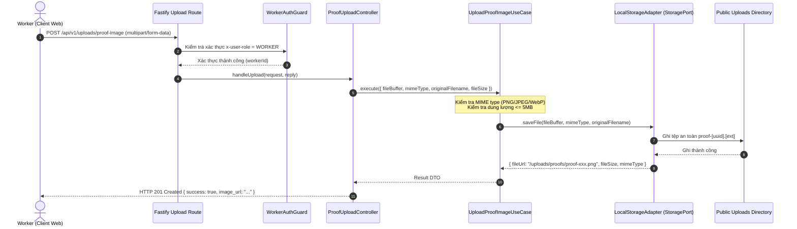
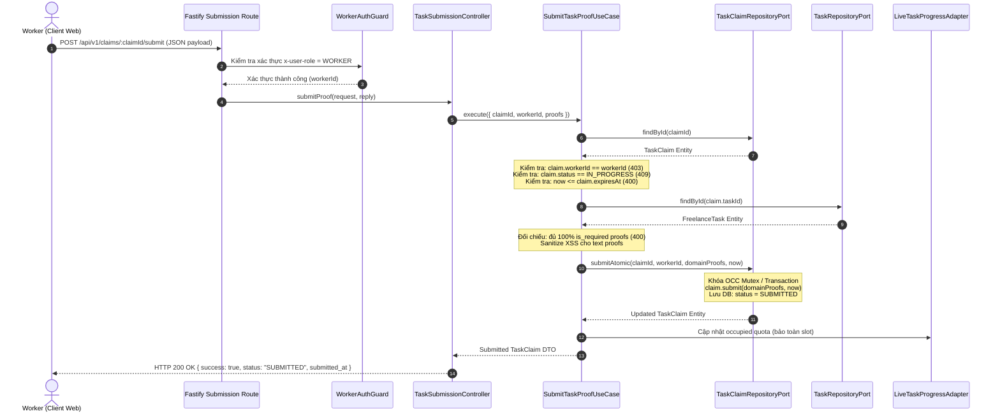
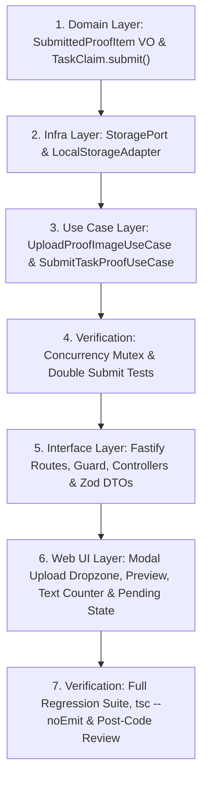

# Kế hoạch kiến trúc: Nộp bằng chứng nhiệm vụ cho Người làm (submit-task-proof)

# Version: 1.0.0
# Status: APPROVED
# Feature Slug: submit-task-proof
# Depth: DETAILED
# Architecture Profile: v1.1.0 (APPROVED — Fastify + PostgreSQL + Prisma + Zod + Vitest)
# Methodology Profile: Depth=DETAILED, Risk=medium, Review Route=File Upload Security & Quota Preservation Integrity, Decision Owner=Admin (@admin)

---

## 1. Phương án kiến trúc (Architectural Approach)

Kế hoạch kiến trúc cho tính năng `submit-task-proof` tuân thủ nghiêm ngặt chuẩn mực **Clean Architecture / Hexagonal Architecture** theo `CONSTITUTION.md` (`ARCH-01`) và các công nghệ đã được phê duyệt trong `.sdd/architecture-profile.md` (Fastify, PostgreSQL, Prisma ORM, Zod, Vitest):

- **Phân tách 4 tầng kiến trúc độc lập (Separation of Concerns):**
  1. **Domain Layer (`src/domain/`):**
     - Xây dựng Value Object `SubmittedProofItem` (`src/domain/value-objects/submitted-proof.vo.ts`) mô hình hóa từng bằng chứng nộp, bảo đảm tính bất biến, xác thực tính toàn vẹn (URL ảnh hợp lệ, chuỗi văn bản không rỗng, 1–500 ký tự).
     - Mở rộng thực thể `TaskClaim` (`src/domain/entities/task-claim.entity.ts`) để gắn mảng bằng chứng `submittedProofs: SubmittedProofItem[]`, mở rộng phương thức `submit(proofs, now)` với các điều kiện chặn (Guard clauses) nghiêm ngặt.
     - Xây dựng các lỗi miền nghiệp vụ kế thừa `DomainError` (`src/shared/errors/claim-errors.ts`): `MissingRequiredProofsError`, `InvalidProofRequirementIdError`, `InvalidProofValueError`, `InvalidFileTypeError`, `FileTooLargeError`, `MissingFileError`, `ClaimExpiredError`, `ForbiddenNotClaimOwnerError`, `ClaimNotInProgressError`.
  2. **Use Case Layer (`src/usecase/`):**
     - `UploadProofImageUseCase`: Tiếp nhận tệp nhị phân, kiểm tra MIME type ảnh (PNG, JPEG, WebP) và giới hạn 5MB, giao tiếp qua `StoragePort` để lưu tệp an toàn.
     - `SubmitTaskProofUseCase`: Điều phối toàn bộ quy trình nộp bài: xác thực quyền sở hữu slot (`claim.workerId === workerId`), kiểm tra thời hạn còn lại (`now <= claim.expiresAt`), đối chiếu 100% bằng chứng bắt buộc với cấu hình của nhiệm vụ, khử mã độc XSS trên text, và chuyển trạng thái `IN_PROGRESS` $\to$ `SUBMITTED`.
     - `GetClaimDetailsUseCase`: Truy vấn chi tiết một lượt claim kèm danh sách bằng chứng đã nộp và trạng thái.
     - Cung cấp các Port trừu tượng: `StoragePort`, `TaskClaimRepositoryPort`, `TaskProgressPort`.
  3. **Interface Layer (`src/interface/`):**
     - Xây dựng Zod Schemas (`src/interface/http/dto/submit-proof.dto.ts`) xác thực chặt chẽ đầu vào.
     - Xây dựng `ProofUploadController` và `TaskSubmissionController`.
     - Cấu hình Fastify Routes (`/api/v1/uploads/proof-image`, `/api/v1/claims/:claimId/submit`, `/api/v1/claims/:claimId`) có gắn `WorkerAuthGuard`.
  4. **Infrastructure Layer (`src/infra/`):**
     - Cung cấp `LocalStorageAdapter` triển khai `StoragePort`, lưu trữ ảnh vào thư mục `public/uploads/proofs/` với tên ngẫu nhiên `proof-[uuid].[ext]`.
     - Cập nhật `InMemoryTaskClaimRepository` và `PrismaTaskClaimRepository` để lưu trữ trường `submitted_proofs` (JSON), bổ sung phương thức `submitAtomic` bảo vệ bằng khóa nguyên tử OCC.
     - Cập nhật `LiveTaskProgressAdapter` để bảo toàn hạn ngạch: tính cả các slot `SUBMITTED` vào số lượng suất đang chiếm dụng của nhiệm vụ.
  5. **Web UI Layer (`public/`):**
     - Mở rộng modal làm nhiệm vụ `task-claim-modal.js`: hiển thị form nộp bằng chứng tương ứng với `proof_requirements` của nhiệm vụ.
     - Tích hợp vùng kéo thả / tải ảnh kèm preview tức thì (Image Preview), bộ đếm ký tự text (0/500), nút "Nộp bài nhận Xu" có trạng thái loading, dừng đếm ngược và hiển thị nhãn "Đang chờ duyệt".

- **Các mẫu thiết kế cốt lõi (Core Design Patterns):**
  - **Storage Port & Local Adapter Pattern:** Tách rời hoàn toàn nghiệp vụ lưu tệp khỏi hệ thống tệp đĩa cứng (Disk I/O). Nghiệp vụ chỉ biết đến `StoragePort`. Khi đưa lên production đám mây, chỉ cần thay thế bằng `S3StorageAdapter` mà không sửa đổi bất kỳ Use Case nào.
  - **Atomic Submit OCC Mutex Pattern:** Khi Worker nộp bài, Use Case phối hợp với Repository thực hiện thao tác kiểm tra trạng thái và lưu bài nộp nguyên tử (Atomic Check-and-Submit), giải quyết triệt để rủi ro nộp đúp (Double Submit Race Condition).
  - **Quota Preservation Pattern:** Đảm bảo $\text{occupied\_slots} = \text{in\_progress} + \text{submitted} + \text{approved}$. Khi slot chuyển sang `SUBMITTED`, số suất khả dụng $\text{remaining\_quota}$ không bị tăng lên, ngăn chặn người khác cướp mất suất làm việc đã nộp bài.

---

## 2. Ánh xạ Yêu cầu sang Thành phần (REQ-to-Component Mapping)

| Mã yêu cầu | Tóm tắt hành vi | Thành phần đảm nhiệm (Component) | Tầng kiến trúc | Đường dẫn tệp tin dự kiến |
| :--- | :--- | :--- | :--- | :--- |
| `REQ-SUB-001` | Upload ảnh PNG/JPEG/WebP $\le 5\text{MB}$ $\to$ 201 Created | `UploadProofImageUseCase` / `LocalStorageAdapter` | Usecase / Infra | `src/usecase/upload-proof-image.usecase.ts` |
| `REQ-SUB-002` | Lỗi 400 `INVALID_FILE_TYPE` khi sai định dạng | `UploadProofImageUseCase` / Error Handler | Usecase / Shared | `src/shared/errors/claim-errors.ts` |
| `REQ-SUB-003` | Lỗi 413 `FILE_TOO_LARGE` khi ảnh $> 5\text{MB}$ | `UploadProofImageUseCase` / Error Handler | Usecase / Shared | `src/shared/errors/claim-errors.ts` |
| `REQ-SUB-004` | Lỗi 400 `MISSING_FILE` khi không đính kèm tệp | `ProofUploadController` | Interface | `src/interface/http/controllers/proof-upload.controller.ts` |
| `REQ-SUB-005` | Tên tệp ngẫu nhiên UUID v4, vô hiệu hóa script | `LocalStorageAdapter` / Web Routes | Infra / Interface | `src/infra/storage/local-storage.adapter.ts` |
| `REQ-SUB-006` | Nộp bài hợp lệ $\to$ chuyển `SUBMITTED`, lưu `submitted_at` | `SubmitTaskProofUseCase` | Usecase | `src/usecase/submit-task-proof.usecase.ts` |
| `REQ-SUB-007` | Lỗi 404 `CLAIM_NOT_FOUND` khi sai claimId | `SubmitTaskProofUseCase` / Claim Repo | Usecase / Infra | `src/shared/errors/claim-errors.ts` |
| `REQ-SUB-008` | Lỗi 403 `FORBIDDEN_NOT_CLAIM_OWNER` khi sai workerId | `SubmitTaskProofUseCase` | Usecase | `src/usecase/submit-task-proof.usecase.ts` |
| `REQ-SUB-009` | Lỗi 400 `CLAIM_EXPIRED` khi nộp quá hạn chót | `TaskClaim.isExpired()` / Use Case | Domain / Usecase | `src/domain/entities/task-claim.entity.ts` |
| `REQ-SUB-010` | Lỗi 409 `CLAIM_NOT_IN_PROGRESS` khi slot không mở | `SubmitTaskProofUseCase` | Usecase | `src/usecase/submit-task-proof.usecase.ts` |
| `REQ-SUB-011` | Lỗi 400 `MISSING_REQUIRED_PROOFS` khi thiếu mục bắt buộc | `SubmitTaskProofUseCase` | Usecase | `src/usecase/submit-task-proof.usecase.ts` |
| `REQ-SUB-012` | Lỗi 400 `INVALID_PROOF_REQUIREMENT_ID` khi requirement lạ | `SubmitTaskProofUseCase` | Usecase | `src/usecase/submit-task-proof.usecase.ts` |
| `REQ-SUB-013` | Lỗi 400 `INVALID_PROOF_VALUE` khi URL ảnh rỗng | `SubmittedProofItem` Value Object | Domain | `src/domain/value-objects/submitted-proof.vo.ts` |
| `REQ-SUB-014` | Lỗi 400 `INVALID_PROOF_VALUE` khi text ngoài 1-500 ký tự | `SubmittedProofItem` Value Object | Domain | `src/domain/value-objects/submitted-proof.vo.ts` |
| `REQ-SUB-015` | Khóa bất biến: cấm sửa, cấm nộp đè, cấm tự hủy | `TaskClaim.canBeCanceled()` | Domain | `src/domain/entities/task-claim.entity.ts` |
| `REQ-SUB-016` | Suất `SUBMITTED` tiếp tục bảo lưu quota | `LiveTaskProgressAdapter` | Infra | `src/infra/adapters/live-task-progress.adapter.ts` |
| `REQ-SUB-017` | Khử mã độc XSS trên toàn bộ chuỗi text | `XssSanitizer` | Shared | `src/shared/utils/xss-sanitizer.ts` |
| `REQ-SUB-018` | API `GET /api/v1/claims/:claimId` xem chi tiết bài nộp | `GetClaimDetailsUseCase` | Usecase | `src/usecase/get-claim-details.usecase.ts` |
| `REQ-SUB-019` | Chống nộp đúp đồng thời (Double Submit Protection) | `submitAtomic` Mutex Lock | Infra / Usecase | `src/infra/repositories/in-memory-task-claim.repository.ts` |
| `REQ-SUB-020` | Khung nộp bằng chứng hiển thị theo `proof_requirements` | `task-claim-modal.js` | Web UI | `public/js/components/task-claim-modal.js` |
| `REQ-SUB-021` | Kéo thả ảnh, preview thu nhỏ, hiển thị dung lượng | `task-claim-modal.js` / API Client | Web UI | `public/js/components/task-claim-modal.js` |
| `REQ-SUB-022` | Ô nhập text hiển thị bộ đếm ký tự `x/500` | `task-claim-modal.js` | Web UI | `public/js/components/task-claim-modal.js` |
| `REQ-SUB-023` | Nút "Nộp bài nhận Xu", loading, dừng đếm ngược, nhãn Chờ duyệt | `task-claim-modal.js` | Web UI | `public/js/components/task-claim-modal.js` |

---

## 3. Danh mục các Thành phần chi tiết (Components by Layer)

### 3.1 Domain Layer (`src/domain/`)

- **`SubmittedProofItem` Value Object (`src/domain/value-objects/submitted-proof.vo.ts`):**
  - Quản lý một mục bằng chứng cụ thể: `requirementId: string`, `proofType: 'SCREENSHOT_IMAGE' | 'TEXT'`, `value: string`.
  - Validate:
    - Nếu `SCREENSHOT_IMAGE`: `value` phải là chuỗi URL an toàn (bắt đầu bằng `http://`, `https://`, hoặc `/uploads/`).
    - Nếu `TEXT`: `value` (sau khi trim) phải có độ dài từ 1 đến 500 ký tự.
- **Thực thể `TaskClaim` mở rộng (`src/domain/entities/task-claim.entity.ts`):**
  - Bổ sung thuộc tính `_submittedProofs: SubmittedProofItem[]`.
  - Cập nhật phương thức `submit(proofs: SubmittedProofItem[], now: Date)`:
    - Kiểm tra `!this.isExpired(now)` và `this._status.isInProgress()`.
    - Chuyển `_status` sang `SUBMITTED`, gán `_submittedAt = now`, lưu `_submittedProofs = proofs`.
    - Cập nhật `_updatedAt = now`.
- **Domain Errors chuẩn hóa (`src/shared/errors/claim-errors.ts`):**
  - Bổ sung các lớp lỗi kế thừa `DomainError` với mã trạng thái HTTP tương ứng:
    - `MissingRequiredProofsError` (400)
    - `InvalidProofRequirementIdError` (400)
    - `InvalidProofValueError` (400)
    - `InvalidFileTypeError` (400)
    - `FileTooLargeError` (413)
    - `MissingFileError` (400)
    - `ClaimExpiredError` (400)
    - `ForbiddenNotClaimOwnerError` (403)
    - `ClaimNotInProgressError` (409)

### 3.2 Use Case Layer (`src/usecase/`)

- **`UploadProofImageUseCase` (`src/usecase/upload-proof-image.usecase.ts`):**
  - Đầu vào: `{ fileBuffer: Buffer, mimeType: string, originalFilename: string, fileSize: number }`.
  - Kiểm tra MIME type (`image/png`, `image/jpeg`, `image/webp`).
  - Kiểm tra dung lượng ($\le 5\text{MB}$).
  - Giao tiếp qua `StoragePort.saveFile(...)`.
  - Đầu ra: `{ image_url: string, file_size: number, mime_type: string }`.
- **`SubmitTaskProofUseCase` (`src/usecase/submit-task-proof.usecase.ts`):**
  - Đầu vào: `{ claimId: string, workerId: string, proofs: Array<{ requirement_id: string; proof_type: 'SCREENSHOT_IMAGE' | 'TEXT'; value: string }> }`.
  - Các bước điều phối:
    1. Lấy `claim` từ `TaskClaimRepositoryPort`. Nếu không tồn tại -> ném `ClaimNotFoundError` (404).
    2. Kiểm tra chủ sở hữu: `claim.workerId === workerId` -> nếu sai ném `ForbiddenNotClaimOwnerError` (403).
    3. Kiểm tra trạng thái: `claim.status.isInProgress()` -> nếu sai ném `ClaimNotInProgressError` (409).
    4. Kiểm tra hạn chót: `!claim.isExpired(now)`. Nếu quá hạn -> gọi `claim.expire(now)`, lưu repo, ném `ClaimExpiredError` (400).
    5. Lấy `task` từ `TaskRepositoryPort`. Lấy danh sách `proof_requirements`.
    6. Kiểm tra toàn vẹn yêu cầu:
       - Mọi `requirement_id` gửi lên phải nằm trong `task.proof_requirements` -> nếu không ném `InvalidProofRequirementIdError` (400).
       - Mọi tiêu chí có `is_required === true` phải có mặt trong `proofs` với giá trị không rỗng -> nếu thiếu ném `MissingRequiredProofsError` (400).
    7. Sanitize nội dung text bằng `XssSanitizer.sanitize()`.
    8. Khởi tạo mảng các `SubmittedProofItem`.
    9. Gọi `TaskClaimRepositoryPort.submitAtomic(claimId, workerId, domainProofs, now)`.
  - Đầu ra: Dữ liệu `TaskClaim` đã nộp `{ id, taskId, workerId, status: 'SUBMITTED', submittedAt, submittedProofs }`.
- **`GetClaimDetailsUseCase` (`src/usecase/get-claim-details.usecase.ts`):**
  - Đầu vào: `{ claimId: string, workerId: string }`.
  - Kiểm tra quyền sở hữu và trả về chi tiết lượt claim kèm các bằng chứng đã nộp.
- **Application Ports (`src/usecase/ports/`):**
  - `StoragePort` (`src/usecase/ports/storage.port.ts`): Định nghĩa giao diện lưu tệp `saveFile(buffer, mimeType, filename): Promise<{ fileUrl, fileSize, mimeType }>`.
  - `TaskClaimRepositoryPort`: Bổ sung phương thức `submitAtomic(claimId, workerId, proofs, now): Promise<TaskClaim>`.
  - `TaskProgressPort`: Điều chỉnh công thức đếm `occupied_slots` tính cả `SUBMITTED`.

### 3.3 Interface Layer (`src/interface/`)

- **DTOs (`src/interface/http/dto/submit-proof.dto.ts`):**
  - `SubmitProofBodyDto`: Zod schema kiểm tra mảng `proofs` chứa `{ requirement_id: z.string().uuid(), proof_type: z.enum(['SCREENSHOT_IMAGE', 'TEXT']), value: z.string().min(1) }`.
- **Controllers:**
  - `ProofUploadController` (`src/interface/http/controllers/proof-upload.controller.ts`): Tiếp nhận tệp multipart, chuyển thành Buffer và gọi `UploadProofImageUseCase`.
  - `TaskSubmissionController` (`src/interface/http/controllers/task-submission.controller.ts`): Xử lý request nộp bài `submitProof` và lấy chi tiết `getClaimDetails`.
- **Routes:**
  - `src/interface/http/routes/upload.routes.ts`: Đăng ký `POST /api/v1/uploads/proof-image` (preHandler: `workerAuthGuard`).
  - `src/interface/http/routes/submission.routes.ts`: Đăng ký `POST /api/v1/claims/:claimId/submit` và `GET /api/v1/claims/:claimId` (preHandler: `workerAuthGuard`).

### 3.4 Infrastructure Layer (`src/infra/`)

- **`LocalStorageAdapter` (`src/infra/storage/local-storage.adapter.ts`):**
  - Lưu tệp vật lý vào thư mục `public/uploads/proofs/`.
  - Đặt tên tệp ngẫu nhiên `proof-${crypto.randomUUID()}.${ext}`.
  - Trả về đường dẫn tĩnh `/public/uploads/proofs/...` hoặc `/uploads/proofs/...`.
- **`InMemoryTaskClaimRepository` mở rộng:**
  - Cập nhật Map lưu trữ `submittedProofs`.
  - Triển khai `submitAtomic` sử dụng `withClaimLock` bảo vệ an toàn đồng thời.
- **`PrismaTaskClaimRepository` mở rộng:**
  - Lưu `submitted_proofs` dưới dạng JSON trong bảng `task_claims`.
  - Triển khai `submitAtomic` với Prisma `$transaction` hoặc OCC version.
- **`LiveTaskProgressAdapter` mở rộng:**
  - Đếm `occupied_slots = in_progress_count (chưa hết hạn) + submitted_count + approved_count`.
  - Đảm bảo $\text{remaining\_quota} = \text{quota} - \text{occupied\_slots}$ luôn chính xác và không bao giờ giải phóng slot đã nộp bài.

### 3.5 Web UI Layer (`public/`)

- **Modal nộp bằng chứng (`public/js/components/task-claim-modal.js`):**
  - Khi `claim.status === 'IN_PROGRESS'`: Hiển thị form nộp bài với từng tiêu chí `ProofRequirement`.
  - Xử lý tải ảnh: Kéo thả tệp, gọi `api.uploadProofImage()`, hiển thị ảnh preview thu nhỏ ngay lập tức, nút "Xóa ảnh" để chọn lại.
  - Xử lý text: Bộ đếm ký tự `x/500`, nhãn `Bắt buộc`.
  - Bấm "Nộp bài nhận Xu": Gọi `api.submitTaskProof()`, loading spinner, dừng đếm ngược, chuyển modal sang trạng thái "Đang chờ duyệt" (Pending Review) kèm thời gian đã nộp.

---

## 4. Luồng Dữ liệu Chi tiết (Data Flows)

### 4.1 Luồng 1: Tải tệp ảnh bằng chứng (`POST /api/v1/uploads/proof-image`)

### 4.2 Luồng 2: Nộp bài bằng chứng (`POST /api/v1/claims/:claimId/submit`)

---

## 5. Phân loại Thay đổi Trạng thái & Checkpoint (State-Change Classification)

| Thành phần / Luồng | Danh mục thay đổi trạng thái | Cần Checkpoint con người? | Biện pháp bảo vệ |
| :--- | :--- | :--- | :--- |
| **Upload tệp ảnh** | `local file creation` | Không | Giới hạn MIME type, giới hạn 5MB, đặt tên ngẫu nhiên UUID chống ghi đè và Path Traversal. |
| **Nộp bài bằng chứng** | `persistence schema/business-data mutation` | Không (đã duyệt trong Spec) | Khóa nguyên tử OCC chống nộp đúp, kiểm tra hạn chót, kiểm tra quyền sở hữu slot. |
| **Bảo lưu Quota** | `shared/public contract` | Không | Công thức tính quota bảo lưu slot `SUBMITTED`, cam kết Zero Over-allocation. |

---

## 6. Ảnh hưởng Hợp đồng Dùng chung (Shared-Contract Impact)

- **Cấu trúc bảng `task_claims`:**
  - Bổ sung trường `submitted_proofs` (JSON) lưu danh sách các mục bằng chứng `{ requirement_id, proof_type, value }`.
  - Tương thích ngược 100% với các tính năng đã phát hành (`browse-and-claim-task`, `post-job`).
- **Giao diện `TaskProgressPort`:**
  - Mở rộng phương thức tính toán tiến độ:
    $$\text{occupied\_slots} = \text{in\_progress\_count} + \text{submitted\_count} + \text{approved\_count}$$
    $$\text{remaining\_quota} = \text{quota} - \text{occupied\_slots}$$
  - Đảm bảo các usecase `BrowsePublicTasksUseCase`, `GetPublicTaskDetailsUseCase`, `ClaimTaskSlotUseCase` tự động bảo toàn hạn ngạch khi bài nộp chuyển sang `SUBMITTED`.

---

## 7. Bản đồ Tính nhất quán (Consistency Map)

| Yêu cầu EARS | Thành phần Plan | Kỳ vọng Task thực thi | Lệnh kiểm định chính xác (Exact Command) | Bằng chứng kiểm định | Post-Code Review Trigger |
| :--- | :--- | :--- | :--- | :--- | :--- |
| `REQ-SUB-001..005` | `UploadProofImageUseCase`, `LocalStorageAdapter` | Xây dựng StoragePort, LocalStorageAdapter & Upload Use Case | `npx vitest run tests/unit/usecase/upload-proof-image.spec.ts` | File upload tests pass, MIME & 5MB size limit pass | `required` |
| `REQ-SUB-006..017` | `SubmittedProofItem`, `TaskClaim.submit()`, `SubmitTaskProofUseCase` | Xây dựng Domain Value Objects & Submit Use Case | `npx vitest run tests/unit/domain/entities/task-claim-submit.spec.ts` | Unit tests domain logic & validation pass | `required` |
| `REQ-SUB-018..019` | Fastify Routes, Guard, Controllers & OCC Mutex | Xây dựng HTTP Routes, DTOs & Concurrency Lock | `npx vitest run tests/integration/api/submit-proof-api.spec.ts` | API integration tests & Double submit mutex pass | `required` |
| `REQ-SUB-020..023` | Modal `task-claim-modal.js` & API Client | Mở rộng Web UI: Vùng tải ảnh, đếm ký tự text, nút nộp bài | `npx vitest run tests/e2e/submit-proof-ui.spec.ts` | E2E Web UI tests pass | `required` |
| `NFR-PERF, SEC, REL` | Toàn bộ hệ thống | Pre-delivery Quality Gate & TypeScript strict check | `npx tsc --noEmit && npx vitest run` | 100% test suite pass, 0 type errors, build clean | `required` |

---

## 8. Thứ tự Thực hiện & Phụ thuộc (Dependencies & Sequencing)

---

## 9. Rủi ro Kỹ thuật & Biện pháp Giảm thiểu (Risks & Mitigations)

1. **Rủi ro R1: Tấn công tệp tải lên độc hại (Malicious File Upload / Path Traversal):**
   - *Mô tả:* Kẻ tấn công tải lên file script (.php, .sh, .exe, .svg chứa XSS) hoặc dùng tên file `../../etc/passwd` để ghi đè hệ thống.
   - *Biện pháp giảm thiểu:*
     - Kiểm tra nghiêm ngặt Content-Type và đuôi mở rộng: chỉ chấp nhận PNG, JPEG, WebP.
     - Sinh tên tệp ngẫu nhiên bằng `crypto.randomUUID()` (ví dụ `proof-uuid.png`), tuyệt đối không dùng tên tệp từ client.
     - Thư mục upload chỉ phục vụ file tĩnh, không cấp quyền thực thi mã kịch bản.
2. **Rủi ro R2: Rò rỉ Hạn ngạch (Quota Leak on Submitted Claim):**
   - *Mô tả:* Khi slot chuyển sang `SUBMITTED`, nếu `TaskProgressPort` không tính slot này vào số lượng đang giữ thì suất sẽ bị nhả ra ngoài cho Worker khác nhận tiếp, gây bội chi ngân sách.
   - *Biện pháp giảm thiểu:* Cập nhật công thức tính occupied quota: $\text{occupied\_slots} = \text{in\_progress} + \text{submitted} + \text{approved}$. Viết integration test chuyên biệt để kiểm chứng slot `SUBMITTED` không làm tăng `remaining_quota`.
3. **Rủi ro R3: Race Condition khi nộp đúp (Double Submit):**
   - *Mô tả:* Worker nhấn đúp chuột nhanh hoặc mạng chập chờn gửi 2 request submit song song trong cùng 1 mili-giây.
   - *Biện pháp giảm thiểu:* Sử dụng khóa nguyên tử `submitAtomic` (OCC Mutex lock tương tự `claim-task-slot`). Request đầu tiên thành công và chuyển trạng thái sang `SUBMITTED`, request thứ hai bị từ chối ngay với mã lỗi 409 `CLAIM_NOT_IN_PROGRESS`.
4. **Rủi ro R4: Tấn công XSS qua Bằng chứng Văn bản (Stored XSS):**
   - *Mô tả:* Worker chèn mã JavaScript độc hại vào ô text nhằm tấn công trình duyệt của Admin khi duyệt bài.
   - *Biện pháp giảm thiểu:* 100% chuỗi text được làm sạch qua `XssSanitizer` trước khi lưu trữ vào cơ sở dữ liệu.

---

## 10. Câu hỏi cho Người đánh giá (Questions for Human reviewer)

### Q1: Phương thức xử lý Multipart File Upload trong Fastify
- **Điều chưa rõ:** Hiện tại `package.json` của dự án đã cài đặt `fastify` và `zod`, nhưng chưa cài đặt `@fastify/multipart`.
- **Assumption hiện tại:** Để xử lý tệp multipart an toàn và chuẩn mực nhất trên Fastify theo Architecture Profile, AI đề xuất cài đặt package chính thức `@fastify/multipart` (v8+ tương thích Fastify v4/v5), hoặc nếu chưa muốn thêm package ngoài thì sử dụng bộ parser buffer multipart nội bộ.
- **Ảnh hưởng nếu assumption sai:** Nếu dự án hạn chế tuyệt đối cài thêm package mới, AI sẽ triển khai parser multipart thuần túy bằng thư viện chuẩn của Node.js (`stream` / `buffer`).
- **Câu hỏi cụ thể:** Admin có chấp thuận việc sử dụng package chính thức `@fastify/multipart` cho Fastify để xử lý upload ảnh an toàn không?

### Q2: Đường dẫn lưu trữ tệp ảnh tĩnh
- **Điều chưa rõ:** Thư mục lưu trữ ảnh bằng chứng nên đặt tại `public/uploads/proofs/` để web routes phục vụ tĩnh trực tiếp, hay đặt tại thư mục bảo mật riêng ngoài `public/`?
- **Assumption hiện tại:** Đặt tại `public/uploads/proofs/` để tận dụng cơ chế phục vụ tài nguyên tĩnh có sẵn của `src/interface/http/routes/web.routes.ts`, đồng thời đảm bảo kiểm tra path traversal an toàn.
- **Ảnh hưởng nếu assumption sai:** Nếu đặt ngoài thư mục `public/`, cần tạo thêm một endpoint chuyên biệt để đọc và stream file ảnh cho client.
- **Câu hỏi cụ thể:** Cấu trúc lưu trữ tại `public/uploads/proofs/` có đáp ứng đúng kỳ vọng của dự án không?

---

## AI Agent Recommendation

- **Status:** PENDING HUMAN REVIEW
- **Scope:** Kế hoạch Kiến trúc Kỹ thuật Pha 2 SDD (`PLAN.md`) cho tính năng Nộp bằng chứng nhiệm vụ (`submit-task-proof`).
- **Recommendation:** Phê duyệt Kế hoạch Kiến trúc `PLAN.md` này để làm cơ sở chuyển sang Pha 3 Phân rã Tác vụ Kỹ thuật (`TASKS.md`). Thiết kế tuân thủ nghiêm ngặt Clean Architecture 4 lớp, bảo đảm an toàn tệp tải lên (StoragePort + LocalStorageAdapter), chống nộp đúp (Atomic OCC Mutex), bảo toàn hạn ngạch nhiệm vụ và kế thừa 100% các công nghệ đã được duyệt trong Architecture Profile v1.1.0.
- **Evidence:** Tuân thủ `SPEC.md` v1.0.0 đã được phê duyệt `APPROVED & LOCKED`, kế thừa các thực thể `TaskClaim` và `ProofRequirement` hiện hữu, đối chiếu với `CONSTITUTION.md` và `Architecture Profile v1.1.0`.
- **Risks and assumptions:** 4 rủi ro kỹ thuật trọng yếu (R1: Upload bảo mật, R2: Bảo toàn Quota, R3: Nộp đúp đồng thời, R4: Chống XSS) đã có giải pháp giảm thiểu rõ ràng; 2 câu hỏi kỹ thuật đã được nêu tại Mục 10.
- **Alternatives considered:** Đã so sánh việc ghép trực tiếp multipart vào endpoint submit vs tách riêng endpoint upload ảnh; phương án tách riêng giúp Web UI preview ảnh tức thì và giữ API nộp bài thuần JSON sạch sẽ.
- **Required human decision:** Human Reviewer có thẩm quyền (Admin) xem xét, giải đáp 2 câu hỏi kỹ thuật tại Mục 10 và ghi nhận quyết định phê duyệt `APPROVED` trong mục `Human Final Review` dưới đây.

---

## Human Final Review

- **Status:** APPROVED
- **Decision:** Duyệt PLAN.md submit-task-proof v1.0.0
- **Reviewer:** Admin
- **Reviewed at:** 2026-11-21T22:28:38+07:00
- **Follow-up:** /sdd-tasks --feature=submit-task-proof

